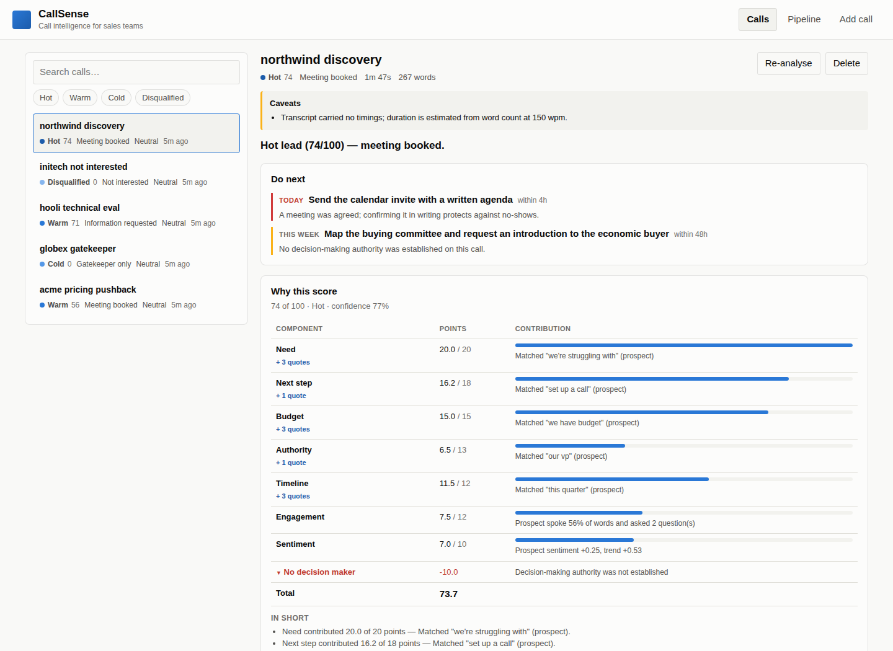
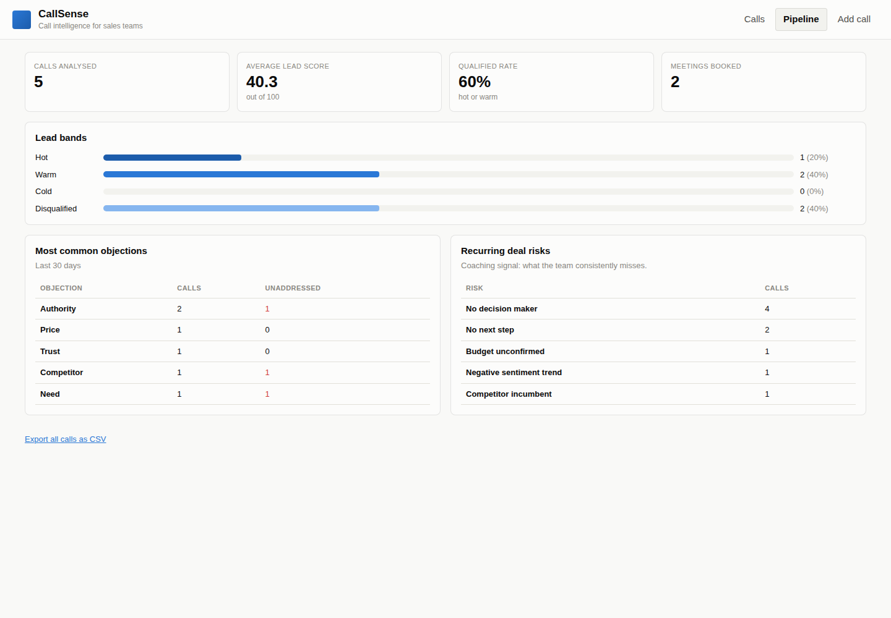
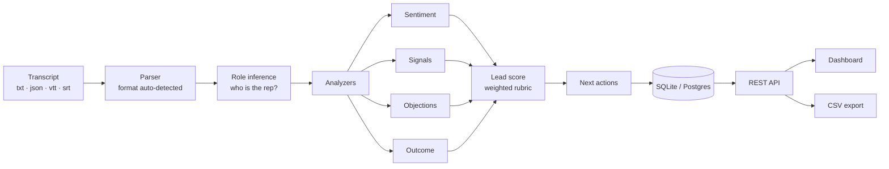

# CallSense

**Turn recorded sales calls into qualified leads, explained scores, and a prioritised follow-up list.**

Upload a call transcript. Get back a lead score you can argue with, the objections
your rep did not answer, and the three things to do before tomorrow.

[](https://github.com/aaron-seq/ML-voice-lead-analysis/actions/workflows/ci.yml)
[](LICENSE)
[](https://www.python.org/downloads/)

---

## The problem

A sales team runs 200 calls a week. The CRM records that the calls happened.
Nobody can answer:

- Which of last week's calls are actually worth chasing?
- Which prospects raised an objection that never got answered?
- Which reps talk for 80% of a discovery call?
- Why is this lead marked "hot"?

Conversation-intelligence tools answer some of this, cost $100+/seat/month, and
require sending every customer conversation to a third party. CallSense is the
self-hosted alternative: it runs on your own infrastructure, on transcripts you
already have, with no per-seat cost and no data leaving your network.

## What it does

| Capability | What you get |
|---|---|
| **Explainable lead scoring** | 0-100 score with every weighted component shown, plus the transcript quote behind each one |
| **Objection detection** | 7 objection types, flagged as **addressed** or **unaddressed**, each with playbook guidance |
| **Buyer intent signals** | 10 signal types mapped to BANT/MEDDIC, attributed to *who said it* |
| **Call outcome classification** | Meeting booked, follow-up agreed, not interested, gatekeeper-only, … |
| **Next-best-action** | Prioritised, time-boxed, with the reason it was suggested |
| **Deal risk flags** | No decision maker, no next step, budget unconfirmed, rep monologue, cooling sentiment |
| **Conversation metrics** | Talk ratio, question counts, sentiment trajectory across the call |
| **Pipeline analytics** | Band distribution, recurring objections, team-wide coaching signals |
| **Export** | One-row-per-call CSV for your CRM or spreadsheet |
| **Observability** | Structured JSON logs with request correlation, Prometheus metrics at `/metrics` |

### Every score is explainable

This is the design constraint everything else follows from. A score a rep cannot
interrogate is a score they will ignore the first time it disagrees with them.

```
  SCORE BREAKDOWN
    need          20.0/20    ████████████████████ Matched "we're struggling with" (prospect)
    next_step     16.2/18    ██████████████████   Matched "set up a call" (prospect)
    budget        15.0/15    ████████████████████ Matched "we have budget" (prospect)
    authority      6.5/13    ██████████           Matched "our vp" (prospect)
    timeline      11.5/12    ███████████████████  Matched "this quarter" (prospect)
    engagement     7.5/12    ████████████         Prospect spoke 56% of words, asked 2 questions
    sentiment      7.2/10    ██████████████       Prospect sentiment +0.30, trend +0.45
    no_decision_maker -10.0                       Decision-making authority was not established
    ────────────────────────────────────────────────────────────────────
    TOTAL         73.9/100   HOT   (confidence 77%)
```

Click any component in the dashboard to see the exact quotes behind it.





---

## Quick start

**Requirements:** Python 3.11+. That's it — no AWS account, no database server,
no model download, no GPU.

```bash
git clone https://github.com/aaron-seq/ML-voice-lead-analysis.git
cd ML-voice-lead-analysis/backend

python -m venv .venv && source .venv/bin/activate   # Windows: .venv\Scripts\activate
pip install -r requirements.txt

# Analyse a call from the command line — no server needed
python -m app.cli.main analyse ../examples/transcripts/northwind-discovery.txt
```

Load the example calls and start the API:

```bash
python -m app.cli.main import ../examples/transcripts
uvicorn app.main:app --reload
```

- API: <http://localhost:8000>
- Interactive docs: <http://localhost:8000/api/v1/docs>
- Health: <http://localhost:8000/health/ready>

The dashboard, in a second terminal:

```bash
cd frontend
npm install
npm run dev     # http://localhost:3000
```

### Docker

```bash
docker compose up --build
```

Brings up the API, the dashboard, and PostgreSQL. See
[docs/DEPLOYMENT.md](docs/DEPLOYMENT.md).

---

## How it works



**Transcript formats** are detected from content, not file extension: AWS
Transcribe, OpenAI Whisper, WebVTT, SRT, diarised plain text (`Rep: hello`), and
undiarised prose.

**Role inference** decides which speaker is selling. It matters more than it
sounds: "we have budget" from the prospect is a qualification signal; the same
words from the rep are a script line. When the evidence is weak the engine
reports `unknown` and scores conservatively rather than guessing.

**The analysis engine is pure Python** — no spaCy, no PyTorch, no transformers on
the default path. It is deterministic (the same transcript always produces the
same score), and every finding carries the transcript span that produced it. A
transformer sentiment analyzer is available as an opt-in upgrade
(`ENABLE_TRANSFORMER_SENTIMENT=true`).

Measured, not asserted — `pytest tests/test_benchmarks.py -s` reproduces these:

| Measurement | Result |
|---|---|
| 40-turn call (396 words) | **2.2 ms** mean, 2.4 ms p95 |
| Per 1,000 words | **5.0 ms** |
| Sustained batch, single thread | **472 calls/s** |
| Scaling: 10× the words | **7.6× the time** (sub-linear) |
| Phrase matcher: 1 → 2,001 phrases | **1.05×** (first-token index) |

Full detail: [docs/ARCHITECTURE.md](docs/ARCHITECTURE.md). Design decisions and
their costs: [docs/adr/](docs/adr/).

---

## Honest limitations

Read this before deciding whether CallSense fits your team.

- **Sentiment has a trained-model option, and it is off on purpose.** A
  classifier trained on real data (SST-2) beats the lexicon by 24.6 points on
  that corpus's own test set and loses by 1.8 points on sales language — domain
  shift, measured rather than assumed. Full numbers and the reasoning:
  [docs/ML.md](docs/ML.md).
- **The lead score is a documented rubric, not a trained model.** The weights in
  [`scoring.py`](backend/app/analysis/scoring.py) encode standard sales
  qualification practice. They have **not** been validated against conversion
  outcomes, because this project ships with no labelled dataset. Treat the score
  as a consistent, explainable prioritisation heuristic — not a probability.
  When you have outcome data, `python -m app.cli.main evaluate labelled.csv`
  reports AUC and per-band conversion rates so you can tune the weights against
  your own funnel. See [docs/SCORING.md](docs/SCORING.md).
- **English only.** The lexicons are English; other languages parse but score
  meaninglessly.
- **Lexicon-based detection has real recall limits.** Novel phrasings are missed.
  The trade-off is deliberate: precision over recall, and total explainability.
- **No audio pipeline.** CallSense analyses transcripts. Bring your own ASR
  (Whisper, AWS Transcribe, your dialer's export).
- **Auth is static API keys with three roles.** Adequate for a single team behind
  a VPN; it is not multi-tenant SSO. See [docs/SECURITY.md](docs/SECURITY.md).
- **Speaker-role inference is heuristic**, roughly reliable on two-party calls
  and weak on multi-party ones.

---

## Documentation

| Document | Contents |
|---|---|
| [ARCHITECTURE.md](docs/ARCHITECTURE.md) | Component map, data flow, design decisions and their trade-offs |
| [API.md](docs/API.md) | Full endpoint reference with examples |
| [SCORING.md](docs/SCORING.md) | The rubric: every weight, threshold and risk flag, and how to tune them |
| [ML.md](docs/ML.md) | The trained sentiment model: real data, real metrics, and why it is not the default |
| [CONFIGURATION.md](docs/CONFIGURATION.md) | Every environment variable |
| [DEPLOYMENT.md](docs/DEPLOYMENT.md) | Docker, Postgres, S3, reverse proxy, production checklist |
| [SECURITY.md](docs/SECURITY.md) | Auth model, threat model, what is and is not protected |
| [TROUBLESHOOTING.md](docs/TROUBLESHOOTING.md) | Common failures and their fixes |
| [ROADMAP.md](docs/ROADMAP.md) | Where this is going, in phases |
| [adr/](docs/adr/) | Architecture decision records — what was decided, why, and what it costs |
| [OPERATIONS.md](docs/OPERATIONS.md) | Running it: logs, metrics, backups, capacity, failure modes |
| [CONTRIBUTING.md](CONTRIBUTING.md) | Dev setup, tests, how to extend the lexicons |

---

## CLI

```bash
callsense analyse call.txt              # analyse one transcript, print a report
callsense analyse call.txt --json       # machine-readable output
callsense import ./transcripts          # bulk-load a directory
callsense evaluate labelled_calls.csv   # validate the rubric against outcomes
callsense train                         # train the sentiment model on real data
callsense keygen --role analyst         # mint an API key
callsense serve                         # run the API
```

(Or `python -m app.cli.main <command>` without installing the package.)

## API at a glance

```bash
# Analyse without storing anything
curl -X POST localhost:8000/api/v1/calls/analyse \
     -H 'Content-Type: application/json' \
     -d '{"transcript": "Rep: Hi...\nProspect: We have budget for this."}'

# Ingest a file
curl -X POST localhost:8000/api/v1/calls/upload -F file=@call.txt

# The hot leads, newest first
curl 'localhost:8000/api/v1/calls?band=hot&sort_by=created_at'

# Team analytics
curl localhost:8000/api/v1/analytics/pipeline
```

Full reference: [docs/API.md](docs/API.md).

## Development

```bash
cd backend
pip install -r requirements-dev.txt

pytest                                  # 208 tests
pytest tests/test_benchmarks.py -s      # performance figures
ruff check app tests                    # lint
mypy app                                # types
bandit -q -r app                        # security static analysis
pip-audit -r requirements.txt --strict  # dependency advisories

cd ../frontend
npm run lint && npm run type-check && npm run build
npm audit --audit-level=high
```

The test suite runs against the real engine, a real database and real storage —
nothing is mocked. `tests/integration/test_contract.py` enforces that an analysis
produced by the engine round-trips through storage and the API unchanged, and
that every field the dashboard reads still exists.

CI additionally runs the integration suite against PostgreSQL, audits both
dependency trees, and boots the API to exercise the documented quick-start on a
clean checkout.

## Contributing

Issues and pull requests welcome. The highest-value contribution is
**lexicon coverage**: if CallSense misses a phrase your team actually uses, add it
to [`lexicons.py`](backend/app/analysis/lexicons.py) with a test. See
[CONTRIBUTING.md](CONTRIBUTING.md).

## License

MIT — see [LICENSE](LICENSE).
