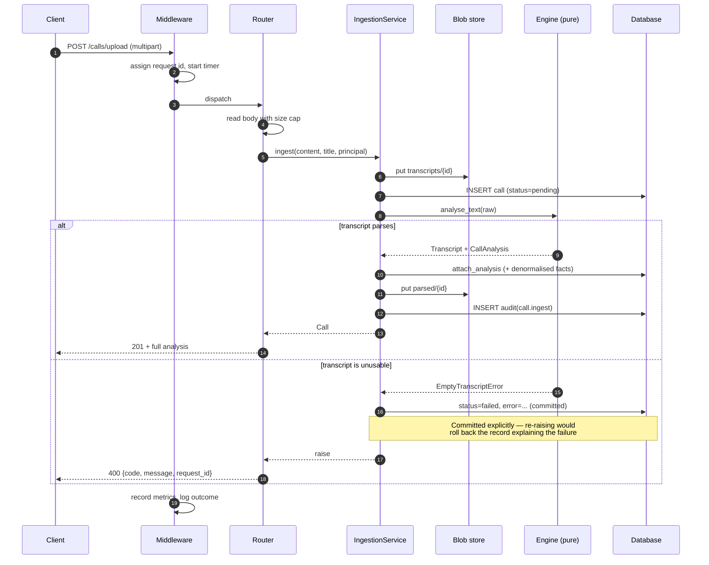
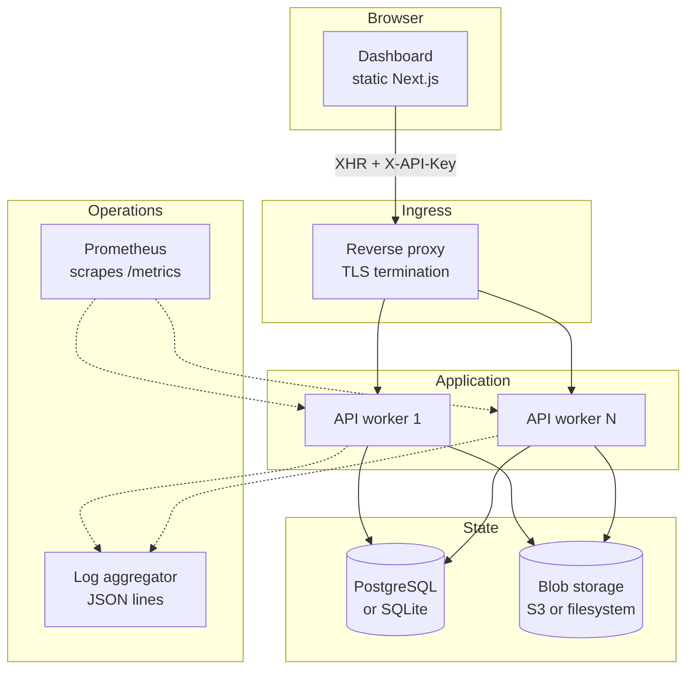
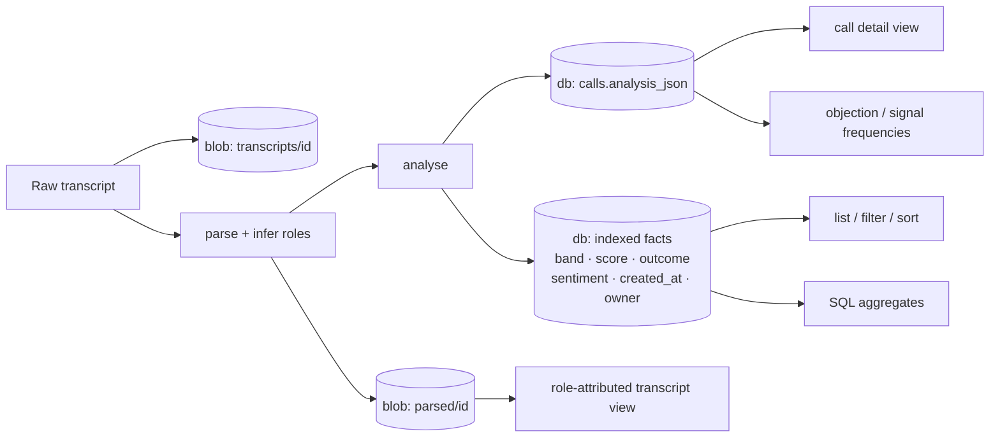

# Architecture

## Component map

```
backend/app/
├── domain/models.py       The contract. Every layer speaks these types.
├── analysis/              Pure functions. No I/O, no framework, no database.
│   ├── parsing.py         Any transcript format → Transcript
│   ├── diarization.py     Which speaker is the rep?
│   ├── lexicons.py        Sales domain knowledge, as reviewable data
│   ├── text.py            Tokenisation + the phrase matcher
│   ├── sentiment.py       Lexicon analyzer (+ optional transformer)
│   ├── signals.py         Buying signals and objections, with evidence
│   ├── outcome.py         Outcome, summary, next actions, talk metrics
│   ├── dynamics.py        Conversation dynamics from segment timings
│   ├── scoring.py         The weighted rubric
│   ├── engine.py          Orchestration — the one public entry point
│   └── evaluation.py      Rubric validation against labelled outcomes
├── db/                    SQLAlchemy models, session, repository
├── storage/               Blob storage: local filesystem or S3
├── services/ingestion.py  The single write path
├── api/                   Routers, schemas, dependencies, middleware
├── cli/main.py            Same engine, terminal interface
└── main.py                Application factory
```

## Data flow

```
                    ┌──────────────────────────────────────┐
  transcript ──────►│ parse → infer roles → analyse        │
  (any format)      │           (pure, deterministic)      │
                    └───────────────┬──────────────────────┘
                                    │ CallAnalysis
                    ┌───────────────▼──────────────────────┐
                    │ IngestionService                     │
                    │  raw blob  → storage/                │
                    │  analysis  → database (JSON + facts) │
                    └───────────────┬──────────────────────┘
                                    │
                    ┌───────────────▼──────────────────────┐
                    │ REST API  ·  CSV export  ·  Dashboard│
                    └──────────────────────────────────────┘
```

## Ingestion sequence

What happens on `POST /api/v1/calls/upload`. The ordering is deliberate: the raw
transcript is durable *before* analysis runs, so a parse failure leaves the
upload recoverable rather than discarded.



## Deployment topology



Note that metrics and rate limits are **per worker** — each worker keeps its own
counters, so Prometheus should treat them as separate targets. See
[OPERATIONS.md](OPERATIONS.md).

## Data flow: where a transcript ends up



The split matters: **indexed facts** answer list and analytics queries without
touching JSON, while the **full analysis** is fetched only for a single call.
That is why `GET /calls` does not hydrate analyses by default.

## Design decisions

### One schema, everywhere

The single most consequential bug in the previous codebase was that the
pipeline serialised analyses as `analyzed_file_name` / `lead_scoring_results`
while the API deserialised `fileName` / `leadScore`. No real analysis was ever
readable through the API; the system only appeared to work because both sides
returned hardcoded mock data in test and CI.

`domain/models.py` is now the only definition of a call analysis. The engine,
the database, the HTTP layer and the CLI all import it.
`tests/integration/test_contract.py` asserts the round trip, so the two sides
cannot drift again.

### The engine is pure

`analysis/` performs no I/O. It takes a string and returns a `CallAnalysis`.
Consequences:

- It is trivially testable — no fixtures, no mocks, no database.
- It is deterministic. The same transcript yields the same score, asserted by
  a test. A scoring system that drifts between runs cannot be debugged or
  trusted.
- It runs anywhere: web request, worker, Lambda, CLI, notebook.

### No heavyweight ML on the default path

The previous implementation required spaCy + a model download, TensorFlow, and
transformers — roughly 2.5 GB — to analyse a text file. It could not run on a
fresh clone, in CI, or in a serverless function.

The engine is now pure Python and the standard library. This is a deliberate
trade:

| | Lexicon engine (default) | Transformer sentiment (opt-in) |
|---|---|---|
| Install | ~15 MB | ~2.5 GB + model download |
| Speed | ~3 ms/call | ~300 ms/call on CPU |
| Deterministic | Yes | Yes, but version-dependent |
| Explainable | Every score traces to a matched phrase | Score only |
| Nuance | Misses novel phrasing | Better on unusual wording |

Enable the transformer with `ENABLE_TRANSFORMER_SENTIMENT=true` and
`pip install -r requirements-ml.txt`. The interface is identical, so nothing
downstream changes shape. If the model fails to load, the engine logs a warning
and falls back to the lexicon rather than failing the analysis.

### A database, not JSON files in a bucket

The previous design used S3 objects as the datastore: listing calls meant a
`list_objects_v2` followed by one `GET` per call to read its summary fields.
Filtering, sorting and aggregation were impossible without downloading
everything.

Now: structured analysis lives in SQL with the queryable facts denormalised into
indexed columns (`lead_band`, `lead_score`, `outcome`, `created_at`, `owner`),
and the full `CallAnalysis` sits beside them as JSON. Raw transcripts stay in
blob storage where large opaque payloads belong. Analytics are SQL aggregates.

SQLite is the default so a clone runs with no services; PostgreSQL is a
connection-string change and is exercised separately in CI.

### Evidence is not optional

Every signal, objection, risk and outcome carries `Evidence`: the segment index,
the verbatim quote, the speaker, their role, and the lexicon phrase that fired.

This is what makes the product defensible rather than plausible. A rep who
disagrees with a score can open the component and read the sentence that
produced it. It also makes the engine debuggable — a wrong score is traceable to
a specific lexicon entry in seconds.

Summaries are **extractive**, never generative. A hallucinated quote on a sales
call is worse than no summary, because a rep will act on it.

### Role attribution over keyword counting

Signals are weighted by who said them (prospect 1.0, unknown 0.7, rep 0.35), and
objections almost entirely discount the rep (0.15). Matching is negation-aware:
"it's not entirely my decision" must not add authority points to a call where
the prospect just said they cannot buy.

The phrase matcher tolerates one skipped function word, because people do not
speak in lexicon entries — "send it over" and "send over" are the same
commitment.

### Metrics are per-worker, and say so

`app/core/metrics.py` implements Prometheus counters and histograms with no
dependency (~80 lines for the three metric types actually needed). Request
metrics are labelled on the matched **route template**, never the request path —
a path label would mint a new time series per call id.

Values are per worker process, exactly like the rate limiter. That is correct
for Prometheus scraping each worker as its own target and misleading if you
expect a global total from one load-balanced scrape, so it is documented rather
than glossed over.

`METRICS_ENABLED=false` returns 404. A test asserts that, because the setting
previously existed and did nothing.

### Confidence is separate from score

A 20-word voicemail can score highly from one lucky phrase. Folding that into
the score would hide the problem; reporting it at confidence 0.3 is honest. The
dashboard shows a warning banner below 0.45.

## Request lifecycle

1. `RequestContextMiddleware` assigns a request id (honouring an inbound
   `X-Request-ID`) into a `ContextVar`, so every log line for that request is
   correlated — including logs emitted outside the request scope.
2. `SecurityHeadersMiddleware` applies CSP, `X-Frame-Options`, nosniff, and HSTS
   (staging/production only — setting it over plain HTTP poisons a developer's
   browser for localhost).
3. CORS, then gzip.
4. Auth resolves the principal from `X-API-Key` and applies the per-principal
   rate limit.
5. The router validates input via Pydantic and delegates to a repository or
   service. Routers contain no SQL.
6. Domain errors (`CallSenseError` subclasses) carry their own HTTP status and
   are rendered as `{code, message, context, request_id}`. Unexpected exceptions
   are logged with a traceback and returned as a generic 500 — an internal
   message never reaches the client.

## Testing strategy

| Layer | What it covers |
|---|---|
| `tests/unit/test_parsing.py` | Every transcript format, plus malformed input |
| `tests/unit/test_analysis.py` | Engine behaviour: negation, role weighting, scoring arithmetic, determinism, lexicon hygiene |
| `tests/unit/test_security_and_storage.py` | Auth, roles, rate limiting, config invariants, path-traversal defence |
| `tests/integration/test_api.py` | Real HTTP against a real database and real storage |
| `tests/integration/test_contract.py` | Engine ↔ storage ↔ API ↔ frontend field contract |
| `tests/unit/test_metrics.py` | Exposition format, label cardinality, the disable switch |
| `tests/test_benchmarks.py` | Latency ceilings, scaling ratio, matcher index behaviour |

Nothing is mocked. CI additionally runs the integration suite against
PostgreSQL, audits both dependency trees (`pip-audit`, `npm audit`, `bandit`),
and boots the API to exercise the documented quick-start on a clean checkout.

The benchmarks assert a *scaling ratio* rather than only absolute times, so they
catch an accidentally quadratic analyzer without failing because a shared CI
runner was busy.
